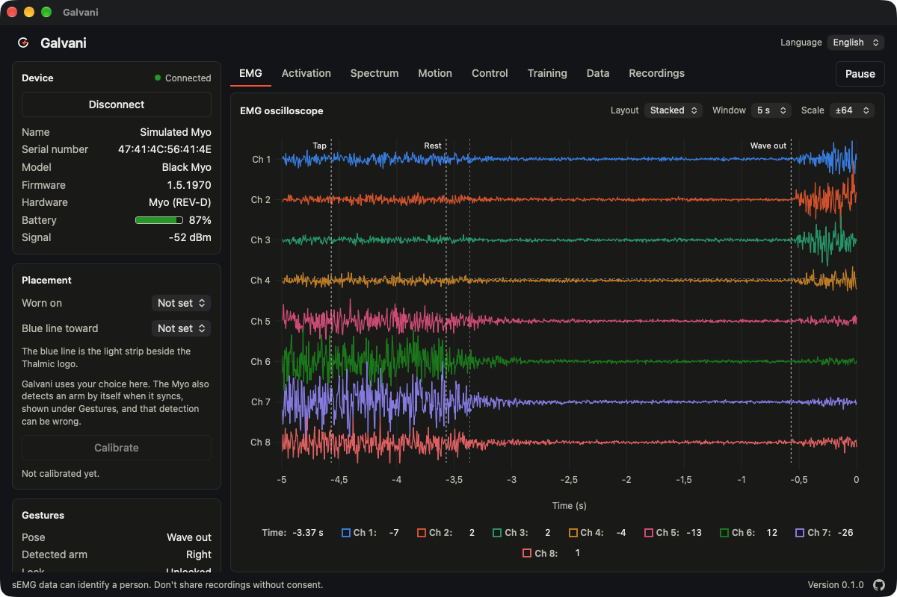
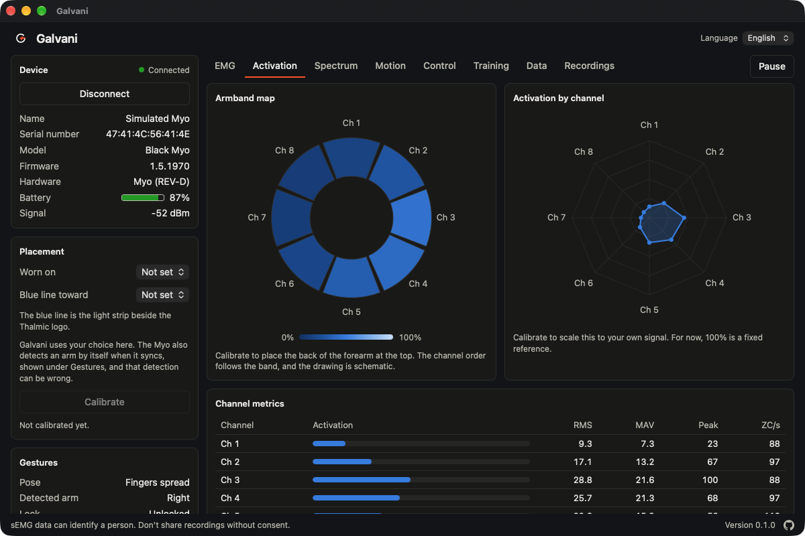
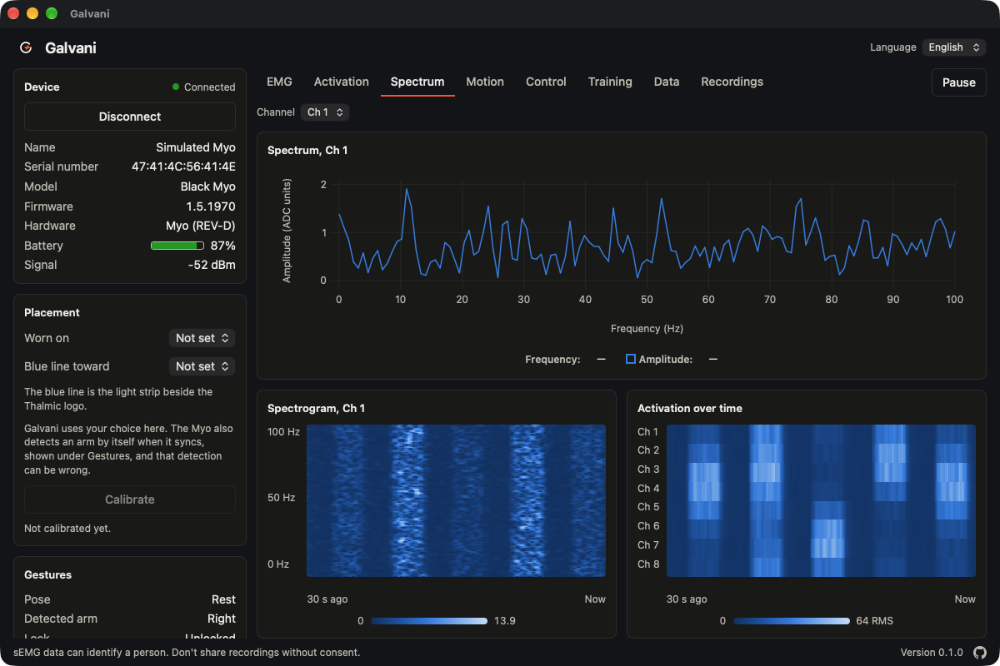
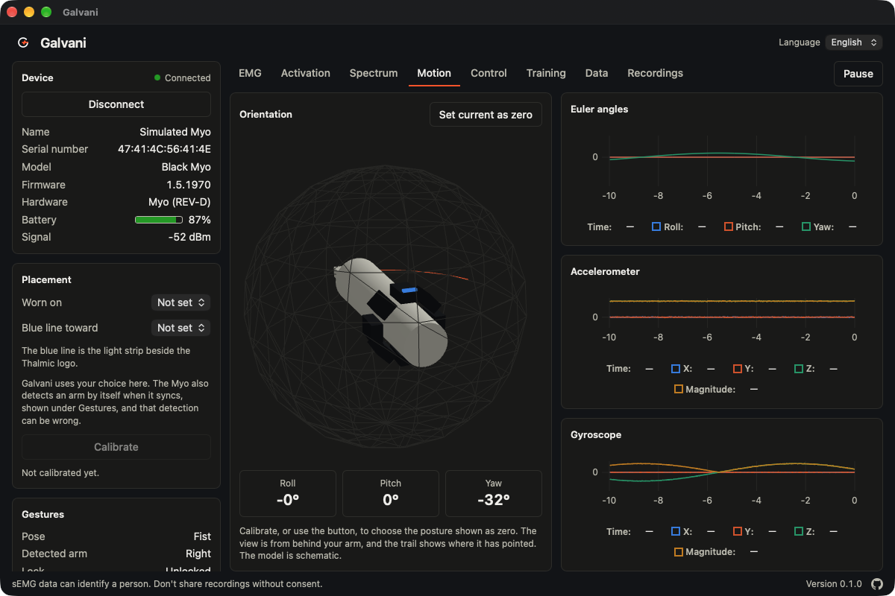
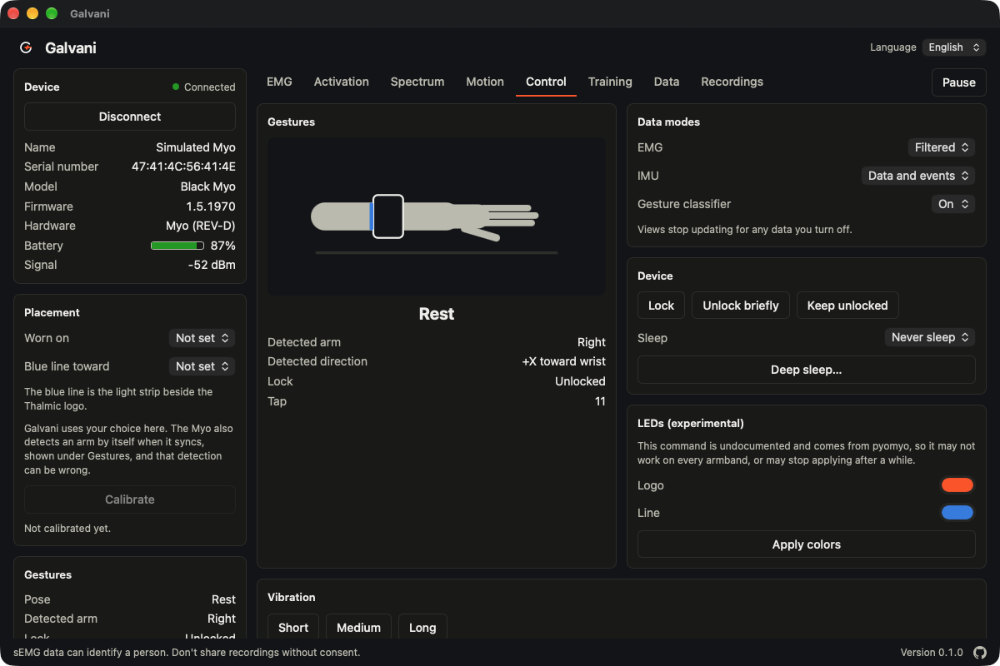

# Galvani

Galvani is a desktop app that brings the discontinued **Thalmic Labs Myo** armband back to life. It talks to the device directly over Bluetooth Low Energy, without the vendor's SDK or Myo Connect, which are no longer distributed.

> **Status:** phase 6 of 6. The app connects to a real Myo over Bluetooth or to a simulated device, and visualizes its EMG and IMU data live, lets you control the armband, records and replays sessions, and learns custom gestures. See the [specification](docs/spec.md).

> **Privacy:** sEMG data can identify a person. Don't share recordings without consent.

## Screenshots

All the screenshots use the simulated device, so the signals are synthetic.



| Activation                                                                                 | Spectrum                                                                                         |
| ------------------------------------------------------------------------------------------ | ------------------------------------------------------------------------------------------------ |
|  |  |

| Motion                                                                                                       | Control                                                                                 |
| ------------------------------------------------------------------------------------------------------------ | --------------------------------------------------------------------------------------- |
|  |  |

## Requirements

Development currently targets macOS on Apple Silicon.

- [Node.js](https://nodejs.org/) and [pnpm](https://pnpm.io/)
- [Rust](https://www.rust-lang.org/) stable
- Xcode
- [Task](https://taskfile.dev/)

## Getting started

Run the app with hot reload:

```bash
task dev
```

Then select **Scan for Myo**, or **Use simulated device** if you have no armband.

macOS asks for Bluetooth permission the first time. With `task dev`, it applies to the terminal that launched the app; a built `.app` asks for itself.

Run `task` to list everything available. The most common tasks are:

| Task               | What it does                                    |
| ------------------ | ----------------------------------------------- |
| `task dev`         | Runs the desktop app with hot reload            |
| `task check`       | Runs the formatting, type, lint and test checks |
| `task fmt`         | Formats the Rust and frontend code              |
| `task build:debug` | Builds a debug `.app`, without installers       |
| `task build`       | Builds the release app and installers           |

## Architecture

```text
Myo ⇄ BleTransport ───────┐
                          ├─ MyoTransport → Session → binary frames → Channel → ring buffer → charts
MockTransport ────────────┘
```

- **`src-tauri/src/myo/protocol.rs`:** pure parsing and serialization of the BLE protocol.
- **`src-tauri/src/myo/transport/`:** the `MyoTransport` trait and its implementations. They deliver raw bytes, so simulated data exercises the same parser as real data.
- **`src-tauri/src/myo/device.rs`:** the session. It configures the device, parses notifications and batches samples into frames of about 16 ms.
- **`src-tauri/src/commands.rs`:** the commands exposed to the frontend.
- **`src/lib/`:** frame decoding, ring buffers and rate measurement, kept outside React state.
- **`src/stores/`:** UI state, in Zustand.
- **`src-tauri/src/myo/dsp.rs`:** per-channel metrics and FFT spectra, sent to the frontend 10 times per second.
- **`src/charts/` and `src/views/`:** the views: EMG oscilloscope with an event timeline, activation, spectrum, motion, device control and live data.
- **`src-tauri/src/profile.rs` and `src/lib/calibration.ts`:** the placement and guided calibration. They are stored in one local JSON file, holding summary values and never recordings.
- **`src-tauri/src/shell.rs`:** the tray icon, background mode and notifications. Closing the window keeps the app running; quit from the tray menu or the app menu.
- **`src-tauri/src/myo/recorder.rs`:** saves each recording as a folder with CSV files and JSON metadata. **`transport/playback.rs`** replays one through the same path as a live device, so all the views work with it.
- **`src/lib/gestures.ts`:** a k-nearest-neighbors classifier for custom gestures, using the RMS of each channel. Its accuracy is measured by holding out whole repetitions.
- **`src/i18n/`:** translations. English is the default, and Spanish is also available.

See [docs/protocol.md](docs/protocol.md) for the protocol and the decisions behind it, and [docs/myo-repos-github-en.md](docs/myo-repos-github-en.md) for related projects.

## Known limitations

- macOS is the only platform tested so far.
- Automatic reconnection has only been tested with simulated connection drops, not with a real Myo losing its connection.
- Resetting the armband when quitting has only been tested with the simulated device.
- Recording and playback have only been tested with the simulated device, not with a real Myo.
- The EMG rate settles around 185–195 Hz on a real Myo, below the nominal 200 Hz, for an unknown reason.
- The simulated signals are synthetic and don't come from recordings.
- The oscilloscope plots samples at the nominal 200 Hz, so lost packets would compress the time axis.
- The theme follows the system setting, with no manual switch.
- The views use tabs. Resizable panels and saved layouts aren't available yet.
- The EMG can't be filtered yet, and there are no band-pass, notch or envelope options.
- The spectra treat samples as evenly spaced, so lost packets add some noise to them.
- The 3D model and armband map are schematic. Which channel sits under the logo isn't known.
- The frontend's tests cover its logic, but not its components.
- Custom gestures are only recognized with the window open, and may need training again after moving the armband.
- The LED command is undocumented, and comes from pyomyo.
- Recordings store the samples and their arrival times. Playback doesn't restore signal strength, because it isn't recorded.
- Latency can't be measured, because the Myo sends no timestamps. Lost samples are estimated against the nominal rate.
- The updater plugin is registered but inactive, until a signing key and a release location are chosen.
